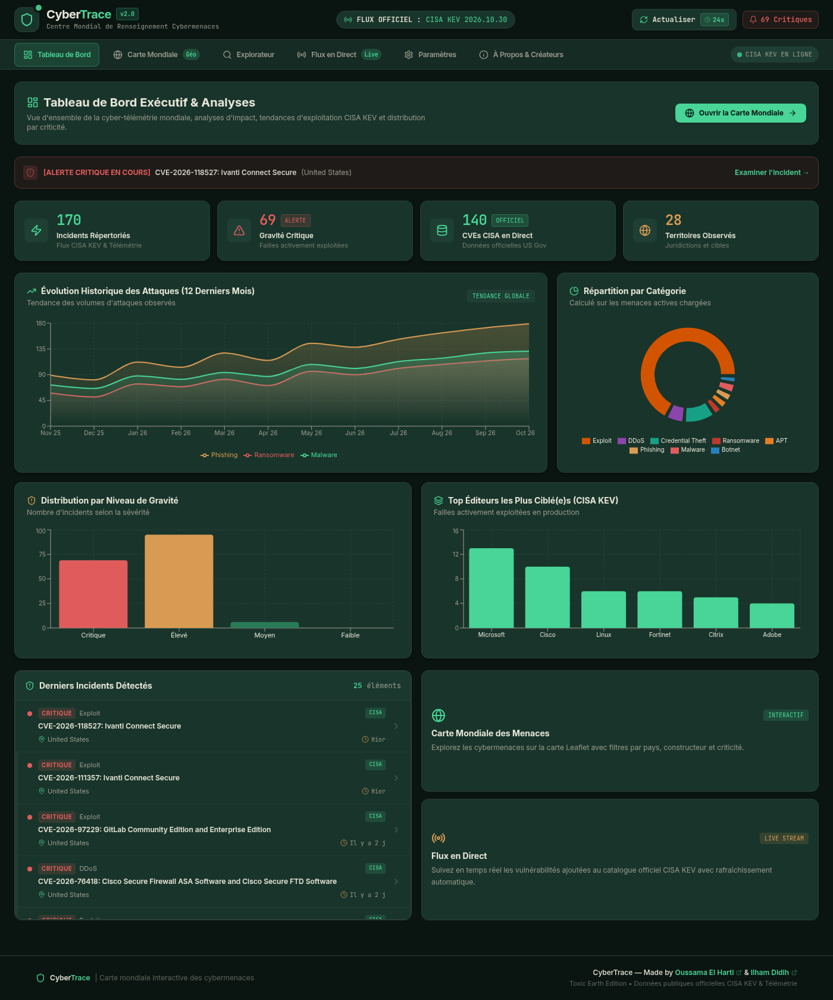
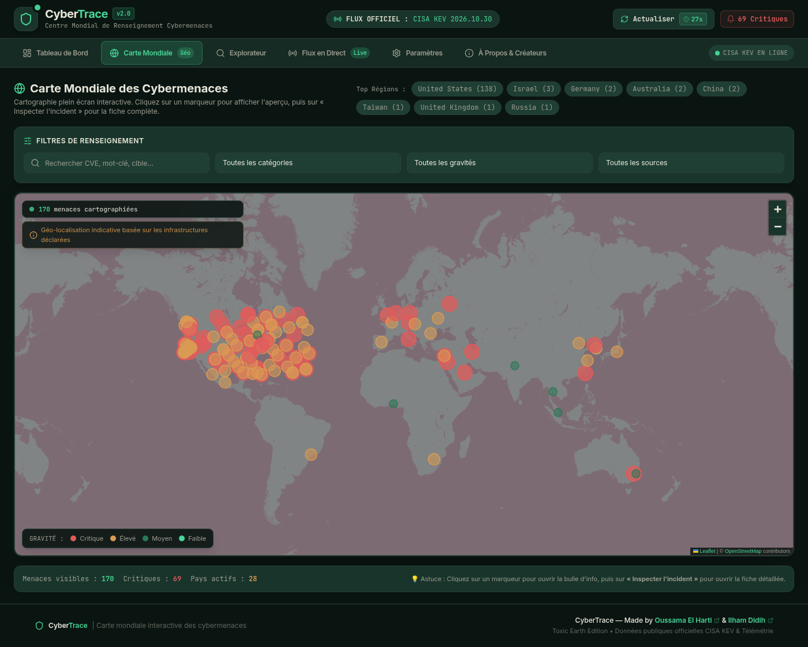
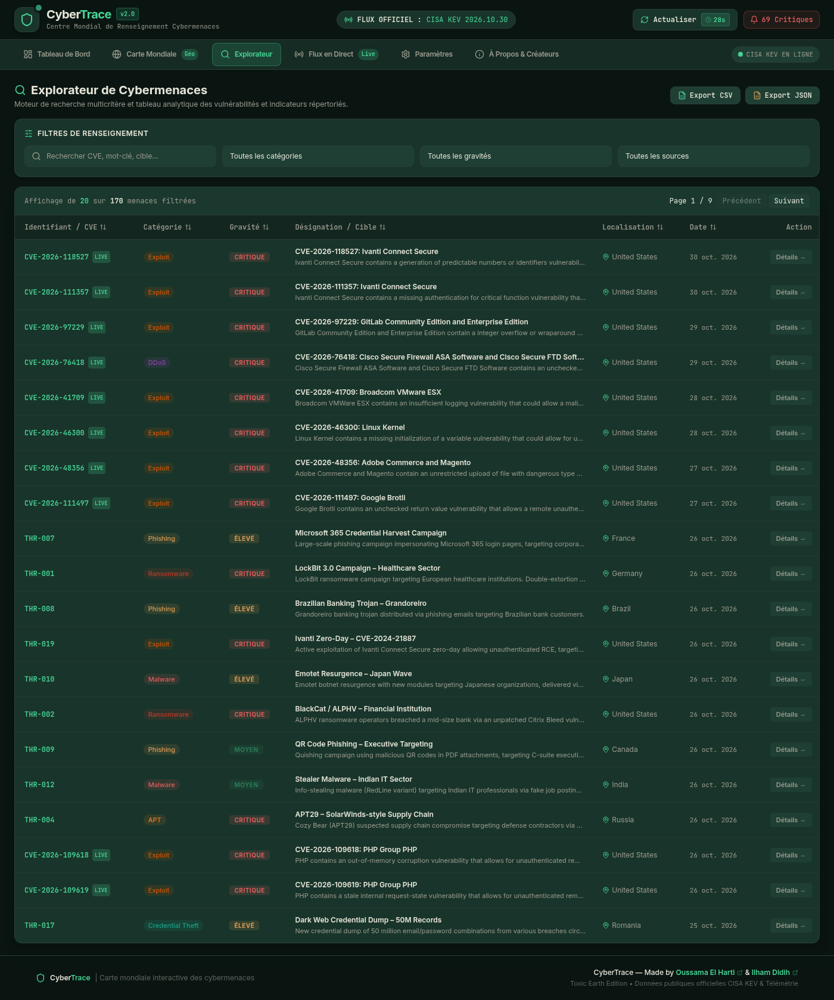

# CyberTrace

Interactive cyber-threat intelligence dashboard: explore CISA's Known Exploited Vulnerabilities catalog on a world map, in charts, and through a searchable incident explorer — all in a French SOC-style UI.



## What it does

- **Dashboard** — KPI banner, 12-month attack trend, severity and category charts, top targeted vendors, recent incidents.
- **World map** — Leaflet map with severity-coloured threat markers, region filters and per-incident detail popups.
- **Threat explorer** — multi-criteria search (CVE, vendor, product, country, severity, category) with pagination and CSV/JSON export.
- **Live feed** — chronological incident stream with manual/automatic refresh against the CISA KEV catalog.
- **Settings** — three visual themes (Toxic Earth default, Void, Gruvbox Cyber) and configurable refresh interval.
- **Resilient data loading** — dev proxy → direct CISA fetch → bundled snapshot fallback.

## Screenshots

| World map | Threat explorer |
| --- | --- |
|  |  |

Full-size images live in [`docs/screenshots/`](docs/screenshots/).

## Stack

| Layer | Technology |
| --- | --- |
| UI | React 18, React Router 6 |
| Build | Vite 6 |
| Styling | Tailwind CSS 3 with CSS-variable theme tokens |
| Charts | Recharts 2 |
| Map | Leaflet 1.9 + React-Leaflet 4 |
| Icons | lucide-react |
| Tests | Vitest |

## Quickstart

Requires Node.js 22.12+ (Vitest 5 requirement) and npm.

```bash
npm install      # install dependencies
npm run dev      # dev server at http://localhost:5173
npm run build    # production bundle in dist/
npm run preview  # serve the production build locally
npm test         # run the Vitest suite
```

During `npm run dev`, Vite proxies `/api/cisa` to the official CISA KEV feed, so the app shows live catalog data. This proxy exists only in the dev server.

## Deployment

The app is a client-side SPA, so every route must fall back to `index.html`:

- **Netlify / Cloudflare Pages** — `public/_redirects` already contains `/*    /index.html   200`.
- **Vercel** — add a rewrite from `/(.*)` to `/index.html` in the project settings.

No environment variables are required. Build with `npm run build` and publish `dist/`.

In production there is no Vite proxy. The app tries the official CISA URL directly; if that request is blocked by CORS or the network, it serves the bundled snapshot at `public/data/cisa_kev_snapshot.json` (catalog `2026.10.23`, released 2026-10-23, 140 entries). Replace that file to ship a newer snapshot.

## Data provenance

- **Real data** — vulnerabilities, vendors, products, CVE IDs, descriptions, due dates and remediation actions come from the public **CISA Known Exploited Vulnerabilities (KEV)** catalog (US Government work, public domain). Markers are placed at approximate vendor headquarters/infrastructure locations, not at confirmed attack origins.
- **Simulated data** — additional ransomware, phishing, APT, DDoS and malware incidents (`src/data/threats.js`) are clearly labelled **Simulated Threat Telemetry** in the UI and in exports. They exist to demonstrate category, geography and severity variety; they are not real incidents.
- The UI exposes a source filter so real and simulated records can be viewed separately. Severity for KEV entries is derived heuristically from the catalog text and dates, not from an official CVSS score.

## Project structure

```
CyberTrace/
├── public/
│   ├── data/cisa_kev_snapshot.json   # bundled CISA KEV fallback
│   └── _redirects                    # SPA rewrite for Netlify-compatible hosts
├── src/
│   ├── components/                   # Header, Navbar, Filters, charts, map, lists, modal
│   ├── views/                        # Dashboard, Map, Explorer, LiveFeed, Settings
│   ├── services/threatService.js     # fetch CISA KEV, map records, export helpers
│   ├── data/threats.js               # simulated telemetry dataset
│   ├── utils/                        # theme tokens and helpers
│   ├── App.jsx                       # router, data loading, shared state
│   └── main.jsx
├── docs/screenshots/                 # README screenshots
└── vite.config.js                    # dev proxy for the CISA feed
```

## Credits

Built by **Oussama El Harti** ([LinkedIn](https://www.linkedin.com/in/oussama-el-harti-b65682249/)) and **Ilham Didih** ([LinkedIn](https://www.linkedin.com/in/ilham-didih-30a809354/)).

Threat data courtesy of the [CISA Known Exploited Vulnerabilities Catalog](https://www.cisa.gov/known-exploited-vulnerabilities-catalog). Map tiles © OpenStreetMap contributors.
